

[English](README.md) · [Tiếng Việt](README.vi.md) · **فارسی**

# دانلود منیجر کیوان (VDM)

<b>دانلود منیجری مینیمال و سریع برای ویندوز و مک، با دانلودر ویدیوی داخلی.</b>

دانلود چندبخشی · دانلود ویدیو از یوتیوب، X و بیش از ۱۰۰۰ سایت · صف و زمان‌بندی · ۱۰ تم

<h3 align="center">دانلود</h3>

<a href="https://github.com/protungtq/vdm/releases/latest/download/VDM-Portable.exe">نسخه‌ی پرتابل ویندوز</a> (بدون نصب) ·
<a href="https://github.com/protungtq/vdm/releases/latest">همه‌ی نسخه‌ها و تغییرات</a> ·
<a href="#نصب">راهنمای نصب</a>

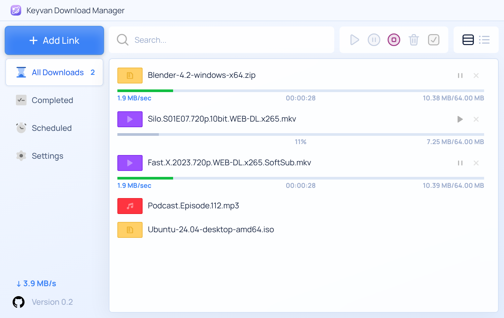

---

## چرا VDM؟

- **ساده و مینیمال:** یک پنجره و یک لیست. بدون تبلیغ، بدون بنر و بدون منوهای شلوغ.
- **سریع:** هر فایل به حداکثر ۳۲ تکه تقسیم می‌شود و همه‌ی تکه‌ها هم‌زمان دانلود می‌شوند.
- **دانلود ویدیو:** لینک یوتیوب یا X را بدهید، کیفیت را انتخاب کنید و تمام.
- **رایگان و متن‌باز** با لایسنس MIT.

---

## امکانات

### ⚡ دانلود چندبخشی (تا ۳۲ اتصال هم‌زمان)

هر فایل به چند تکه تقسیم می‌شود و تکه‌ها هم‌زمان دانلود می‌شوند. وقتی یک اتصال زودتر کارش تمام شود، نصف بزرگ‌ترین تکه‌ی باقی‌مانده را برمی‌دارد، تا همه‌ی اتصال‌ها تا آخر مشغول بمانند (مثل IDM). با دکمه‌ی **Details** نقشه‌ی زنده‌ی همه‌ی اتصال‌ها را می‌بینید.

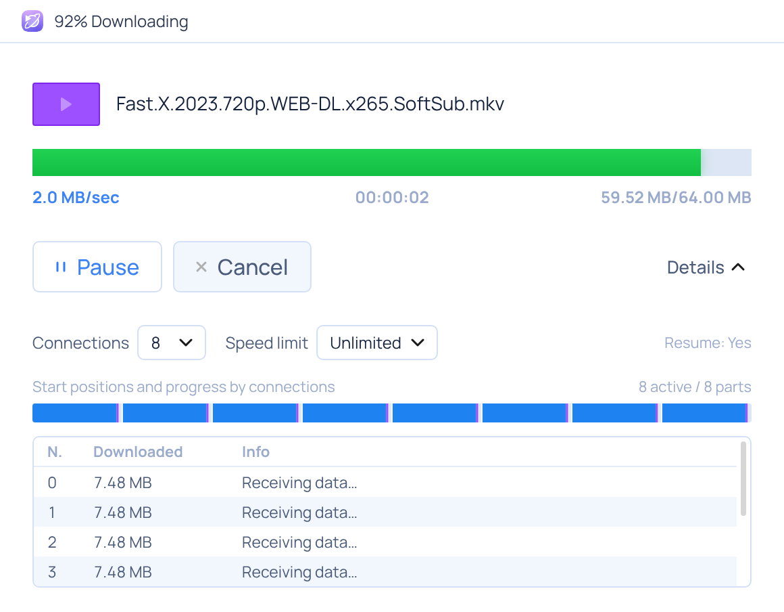

- **ادامه‌ی دانلود** بعد از توقف، بسته شدن برنامه، ری‌استارت یا قطع شدن اینترنت
- تلاش دوباره‌ی خودکار وقتی اتصال قطع می‌شود
- اگر سرور دانلود چندبخشی را پشتیبانی نکند، با یک اتصال ادامه می‌دهد
- **Refresh link:** لینک منقضی‌شده را با لینک تازه عوض کنید، بدون اینکه چیزی از دانلود قبلی از دست برود
- محدودیت سرعت برای هر دانلود یا برای کل برنامه

### 🎬 دانلود ویدیو (یوتیوب، X، اینستاگرام، تیک‌تاک، Vimeo، آپارات و بیش از ۱۰۰۰ سایت)

لینک صفحه‌ی ویدیو را در **Add Link** بگذارید. VDM ویدیو را پیدا می‌کند و کیفیت‌های موجود را با حجمشان نشان می‌دهد. 4K، 1080p، 720p یا **فقط صدا (MP3)** را انتخاب کنید. تصویر و صدای کیفیت‌های بالا خودکار در یک فایل ترکیب می‌شوند.

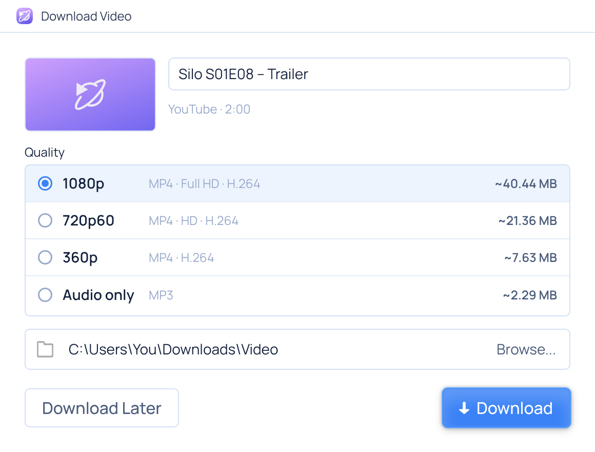

در بخش **Video downloads** تنظیمات، کیفیت پیش‌فرض، دکمه‌ی مرورگر و آپدیت ابزارهای دانلود ویدیو را تنظیم می‌کنید.

> دانلود ویدیو با کمک [yt-dlp](https://github.com/yt-dlp/yt-dlp) و [ffmpeg](https://ffmpeg.org) انجام می‌شود که VDM اولین بار خودش دانلودشان می‌کند (حدود ۵۴ مگابایت). سرویس‌های دارای قفل کپی‌رایت (DRM) مثل نتفلیکس و اسپاتیفای پشتیبانی نمی‌شوند.

### 🌐 افزونه‌ی مرورگر (کروم، اج، بریو)

- دانلودهایی که در مرورگر شروع می‌کنید مستقیم به VDM می‌روند
- وقتی موس را روی ویدیویی در هر سایتی ببرید، دکمه‌ی **Download video** ظاهر می‌شود
- پنجره‌ی افزونه همه‌ی ویدیوهای پیدا‌شده در صفحه را نشان می‌دهد (HLS `.m3u8`، DASH `.mpd`، MP4، WebM)
- گزینه‌ی **دانلود همه‌ی لینک‌های صفحه**، و *Download with VDM* با راست‌کلیک روی هر لینک

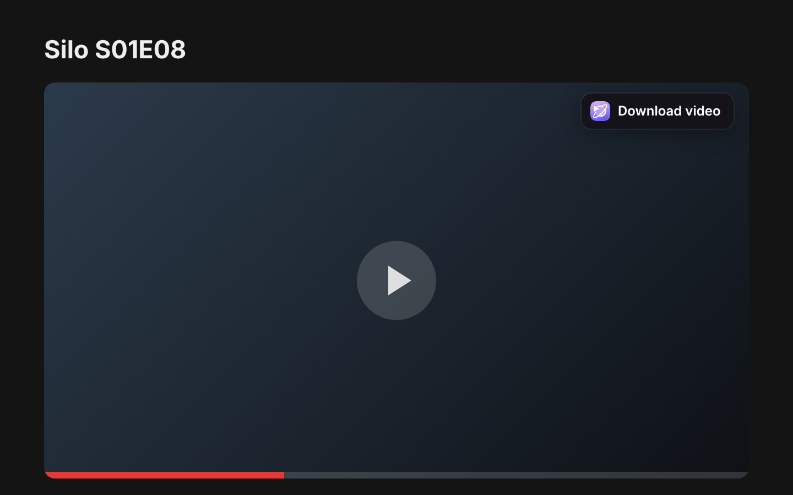
&nbsp;
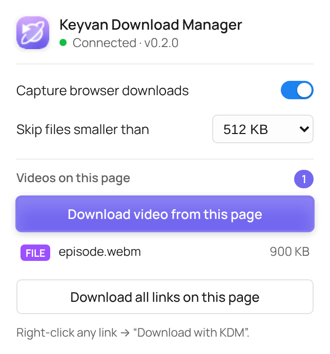

### 📦 دانلود چند فایل با هم

چند لینک را با هم کپی کنید، روی پنجره بکشید، یا الگویی مثل `https://site.com/Silo.S01.part[01-06].rar` بنویسید. VDM لیست فایل‌ها را نشان می‌دهد تا هر کدام را خواستید انتخاب کنید و همان لحظه دانلود کنید یا به صف اضافه کنید.

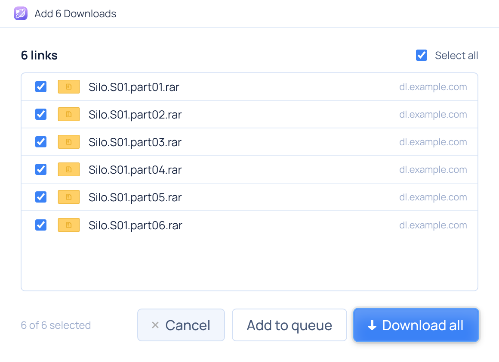

### 🗓️ صف دانلود و زمان‌بندی

- **هر تعداد صف که بخواهید** بسازید (مثلاً «دانلودهای شبانه»). هر صف زمان‌بندی، تعداد دانلود هم‌زمان و کار بعد از تمام شدن مخصوص خودش را دارد. با راست‌کلیک می‌توانید دانلود را به صف دیگری ببرید
- هر صف فایل‌ها را **یکی‌یکی** دانلود می‌کند (اگر بخواهید می‌توانید تعداد را بیشتر کنید)
- **شروع** و **توقف** خودکار صف در ساعت و روزهای دلخواه، مثلاً شب‌ها که اینترنت ارزان‌تر است
- **بعد از تمام شدن صف:** خاموش کردن، Sleep، Hibernate (فقط ویندوز) یا بستن VDM، با ۶۰ ثانیه فرصت برای لغو

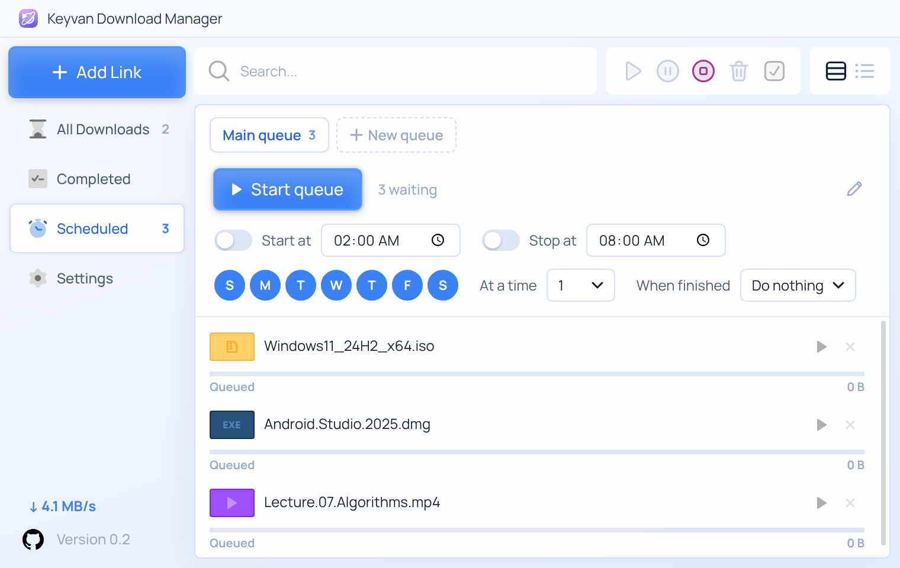

### 🎨 ۱۰ تم

روشن (پیش‌فرض) و تیره، به‌علاوه‌ی **Day، Night، Paper، Mint، Ocean، Neon، Jungle** و **Retro 95**. نوار عنوان پنجره هم با هر تم هماهنگ می‌شود.

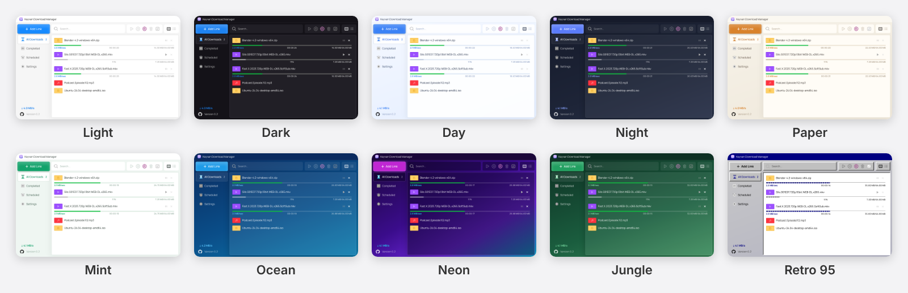

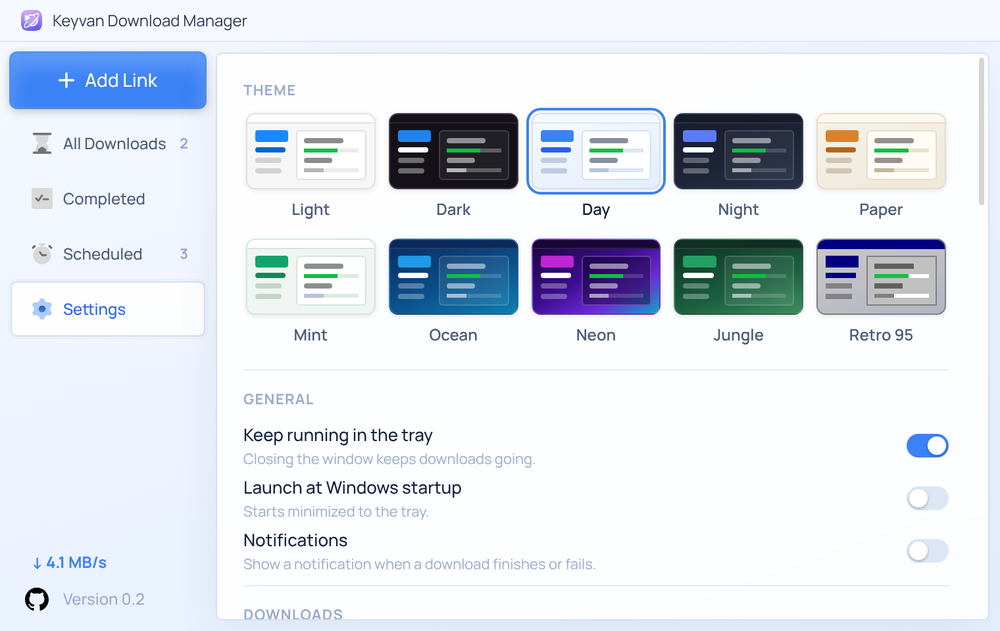

### 🧭 چیزهای کوچکی که کار را راحت می‌کنند

- نمای **کارتی** و **لیست فشرده**، جست‌وجو، و نوار ابزار برای ادامه، توقف و حذف دانلودها

  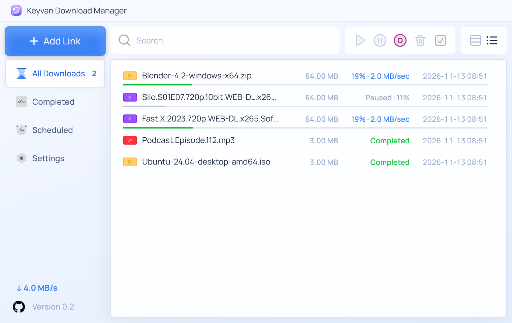

- قبل از دانلود، اسم فایل، حجمش و فضای خالی دیسک را می‌بینید

  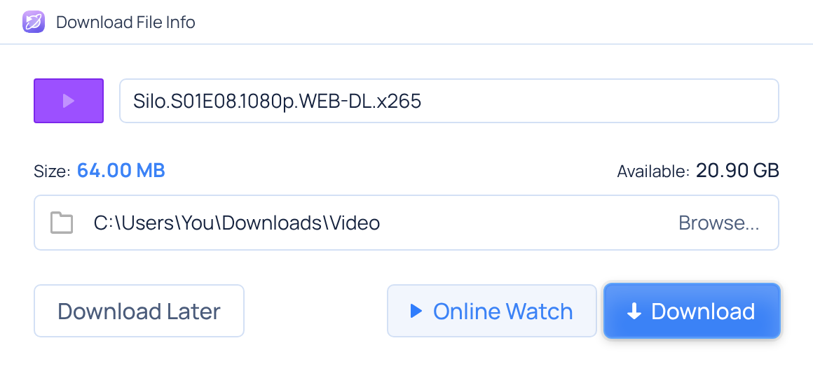

- **Online Watch:** ویدیو یا آهنگ را قبل از تمام شدن دانلود پخش کنید (یا در VLC و PotPlayer باز کنید)
- مرتب کردن خودکار فایل‌ها در پوشه‌های ویدیو، موزیک، فشرده، اسناد و برنامه‌ها
- وقتی لینک دانلودی را در هر برنامه‌ای کپی کنید، پنجره‌ی *Add Link* خودش باز می‌شود
- دانلودهای لغوشده در لیست می‌مانند تا بعداً دوباره شروعشان کنید
- **پراکسی:** HTTP، SOCKS5 یا پراکسی سیستم، با نام کاربری و رمز اختیاری، برای دانلودها، ویدیوها و آپدیت (تنظیمات ← Proxy، با دکمه‌ی *Test connection*)

  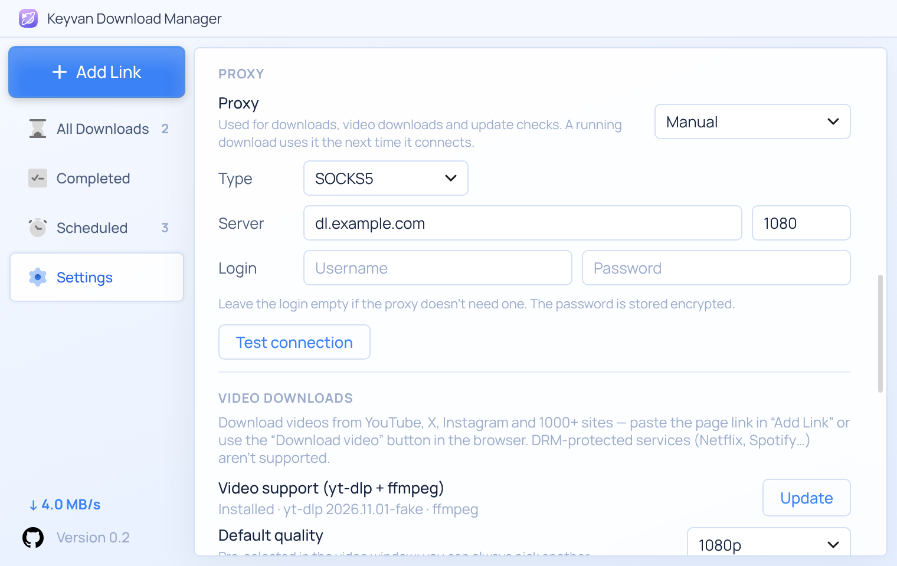

- ستون **Last try** در لیست فشرده زمان آخرین تلاش برای هر دانلود را نشان می‌دهد
- بعد از هر آپدیت، پنجره‌ی **What's new** می‌گوید چه چیزهایی عوض شده (از تنظیمات ← About هم دوباره باز می‌شود)

  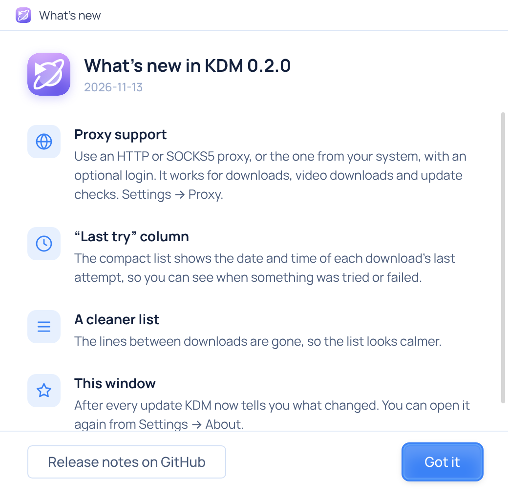

- آیکون در نوار وظیفه، نمایش پیشرفت روی دکمه‌ی برنامه، اعلان‌ها، و جلوگیری از Sleep شدن سیستم وسط دانلود
- محاسبه‌ی SHA-256 فایل‌های دانلودشده
- **آپدیت خودکار:** VDM نسخه‌ی جدید را از گیت‌هاب پیدا می‌کند، دکمه‌ی *Update Available!* را در سایدبار نشان می‌دهد و با یک کلیک دانلود و نصبش می‌کند (از تنظیمات قابل خاموش کردن است)
- انتخاب چند دانلود با `Shift`+کلیک (یک بازه) یا `Ctrl`+کلیک، یا همه با دکمه‌ی **Select all** یا `Ctrl+A`، و ادامه، توقف یا حذف همه با هم (با یک بار تأیید و امکان حذف فایل‌ها از دیسک)
- میانبرهای صفحه‌کلید: `Ctrl+N` افزودن لینک · `Ctrl+F` جست‌وجو · `Ctrl+V` چسباندن لینک · `Space` توقف یا ادامه · `Enter` باز کردن · `Delete` لغو یا حذف

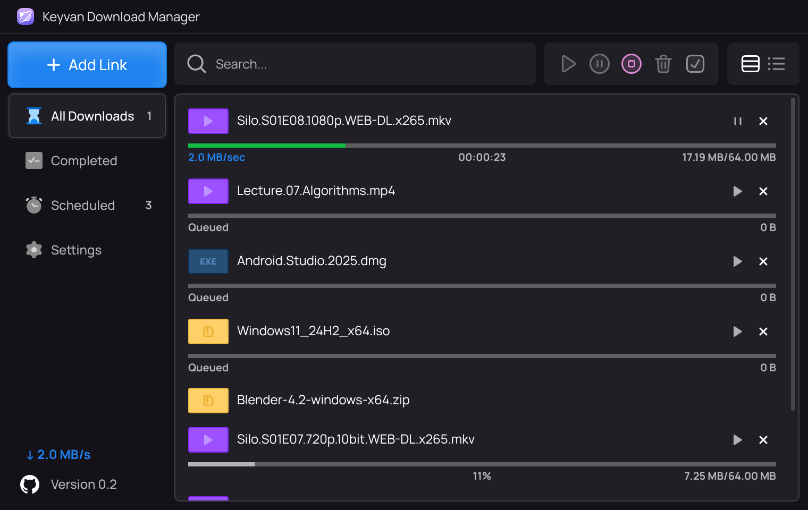

---

## نصب

از دکمه‌های دانلود بالای همین صفحه استفاده کنید، یا فایل دلخواه را از صفحه‌ی [Releases](https://github.com/protungtq/vdm/releases/latest) بردارید.

### ویندوز ۱۰ و ۱۱

1. [نسخه‌ی نصبی](https://github.com/protungtq/vdm/releases/latest/download/VDM-Setup.exe) را دانلود کنید، یا اگر نمی‌خواهید چیزی نصب کنید [نسخه‌ی پرتابل](https://github.com/protungtq/vdm/releases/latest/download/VDM-Portable.exe) را.
2. برنامه هنوز امضای دیجیتال ندارد، برای همین ممکن است ویندوز هشدار SmartScreen بدهد. روی **More info** و بعد **Run anyway** بزنید.

### مک (macOS 11 به بعد)

1. فایل مخصوص مک خودتان را دانلود کنید:
   - [اپل سیلیکون (M1، M2، M3، M4…)](https://github.com/protungtq/vdm/releases/latest/download/VDM-mac-arm64.dmg)
   - [اینتل](https://github.com/protungtq/vdm/releases/latest/download/VDM-mac-x64.dmg)

   نمی‌دانید مکتان کدام است؟ منوی اپل ← **About This Mac** ← جلوی *Chip* نوشته Apple M… یا Intel.
2. فایل `.dmg` را باز کنید و **VN Download Manager** را داخل **Applications** بکشید.
3. برنامه هنوز توسط اپل تأیید (notarize) نشده، برای همین بار اول مک اجازه‌ی باز شدنش را نمی‌دهد. به **System Settings ← Privacy & Security** بروید، پایین صفحه کنار پیام مربوط به VDM روی **Open Anyway** بزنید. (در macOS 14 و قدیمی‌تر می‌توانید روی برنامه راست‌کلیک کنید و **Open** را بزنید.)

### افزونه‌ی مرورگر

1. `chrome://extensions` (یا `edge://extensions`) را باز کنید و **Developer mode** را روشن کنید.
2. روی **Load unpacked** بزنید و پوشه‌ی افزونه را انتخاب کنید. برای پیدا کردنش در VDM به **Settings ← Browser integration ← Open extension folder** بروید.

---

## حریم خصوصی و امنیت

- VDM حساب کاربری، تبلیغ و ردیابی ندارد و به‌جز دانلودهای خودتان و چک کردن آپدیت از گیت‌هاب، چیزی به جایی نمی‌فرستد.
- کوکی‌های مرورگر (برای دانلود از سایت‌هایی که در آن‌ها وارد شده‌اید) فقط برای دانلودهای ناتمام نگه داشته می‌شوند، با رمزگذاری خود سیستم‌عامل (DPAPI ویندوز و Keychain مک) ذخیره می‌شوند و بعد از تمام شدن دانلود پاک می‌شوند.
- برنامه فقط از افزونه‌ی خود VDM دانلود قبول می‌کند؛ سایت‌ها و افزونه‌های دیگر نمی‌توانند به آن دستور بدهند.
- yt-dlp و ffmpeg قبل از استفاده با کد SHA-256 منتشرشده‌شان بررسی می‌شوند.
- فایل‌های نصبی هنوز امضای دیجیتال ندارند (این کار گواهی پولی لازم دارد)، برای همین ویندوز و مک بار اول هشدار می‌دهند. همیشه می‌توانید VDM را خودتان از همین سورس بسازید.

## سازنده

**مجتبی نواده** · [تلگرام](https://t.me/mojtabatn) · [اینستاگرام](https://www.instagram.com/mojtabanavade)

برای ساختن برنامه از سورس و جزئیات فنی، [نسخه‌ی انگلیسی](README.md#build-from-source) را ببینید.

## لایسنس

MIT. متن کامل در فایل [LICENSE](LICENSE).

