<div align="center">

**English** · [Tiếng Việt](README.vi.md) · [فارسی](README.fa.md)


# VN Download Manager

**A minimal, fast download manager for Windows and macOS, with a built-in video downloader.**

Multi-connection downloads · Video grabber for YouTube, X and 1000+ sites · Queue and scheduler · 10 themes

### Download

<a href="https://github.com/protungtq/vdm/releases/latest/download/VDM-Setup.exe"></a>
<a href="https://github.com/protungtq/vdm/releases/latest/download/VDM-mac-arm64.dmg"></a>
<a href="https://github.com/protungtq/vdm/releases/latest/download/VDM-mac-x64.dmg"></a>

[Portable Windows version](https://github.com/protungtq/vdm/releases/latest/download/VDM-Portable.exe) (no installation) ·
[All versions and what's new](https://github.com/protungtq/vdm/releases/latest) · [How to install](#install)

[](https://github.com/protungtq/vdm/releases/latest)


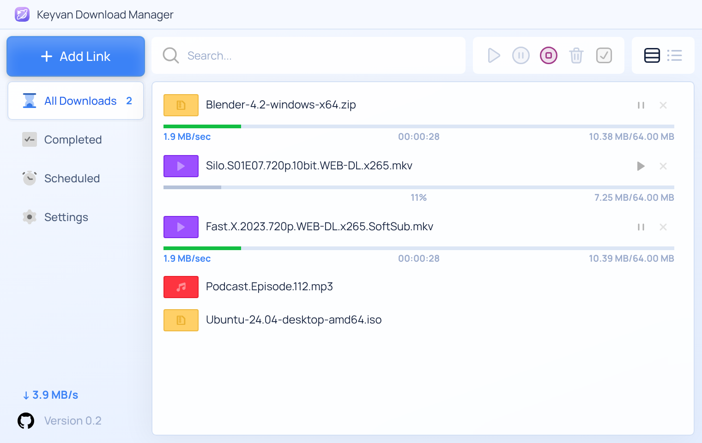

</div>

> **About this fork.** VN Download Manager (VDM) is a renamed and rebranded fork of
> [Keyvan Download Manager](https://github.com/mojtabatn/keyvan-download-manager) by Mojtaba Navade,
> published under the same MIT license. The original author's copyright notice is kept in
> [LICENSE](LICENSE), and the app's About screen still credits him. All features below come from the
> original project; this fork only changes the name, the branding and the update location.

---

## Why VDM?

- **Clean and minimal.** One window, one list. No ads, no banners, no menus full of options you never use.
- **Fast.** Each file is split into up to 32 parts that download at the same time.
- **Videos too.** Paste a YouTube or X link, pick a quality, done.
- **Free and open source** under the MIT license.

---

## Features

### ⚡ Multi-part downloads (up to 32 connections)

Each file is split into parts that download in parallel. When one connection finishes early, it takes over half of the
biggest remaining part, so all connections stay busy until the end (*dynamic segmentation*, as in IDM).
**Details** shows a live map of every connection.

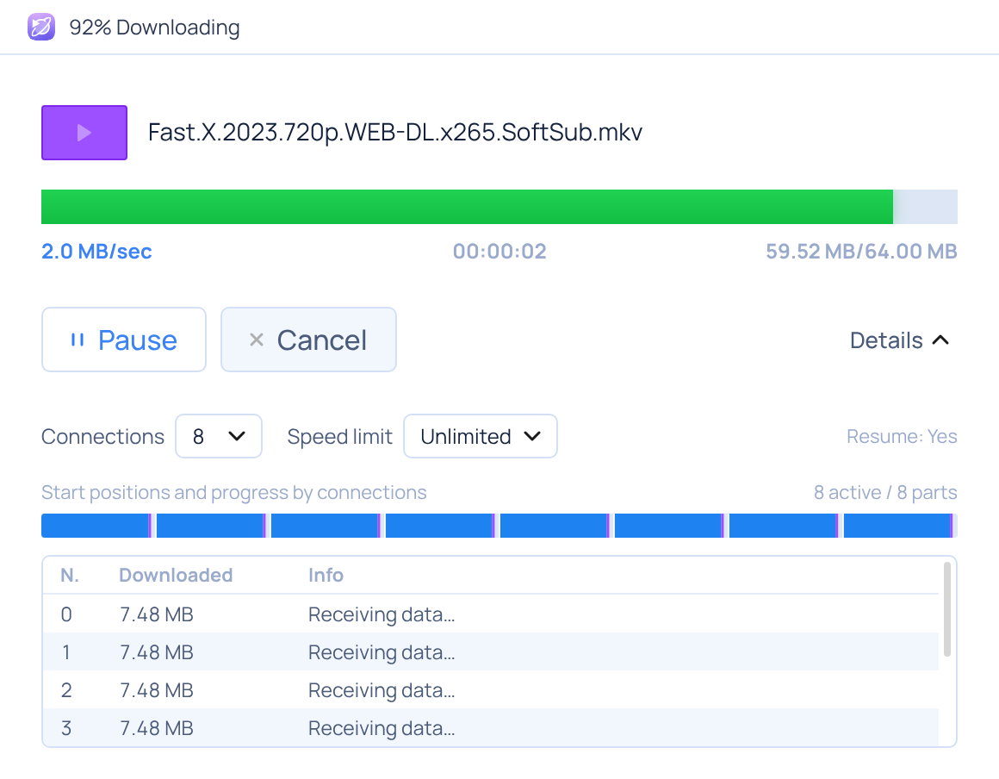

- **Resume** after a pause, a crash, a restart or a lost connection
- Automatic retries with backoff
- Falls back to a single connection when a server doesn't support multi-part downloads
- **Refresh link**: replace an expired link with a fresh one and keep what was already downloaded
- Speed limit per download, or for all downloads

### 🎬 Video downloader (YouTube, X, Instagram, TikTok, Vimeo, Aparat and 1000+ sites)

Paste the page link into **Add Link**. VDM finds the video and lists the available qualities with their sizes.
Choose 4K, 1080p, 720p… or **Audio only (MP3)**. VDM merges HD video and audio into one file automatically.

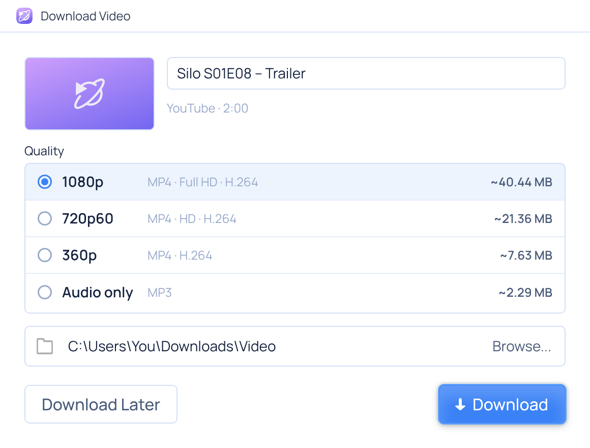

The **Video downloads** section of Settings sets the default quality, the browser button and the download-tool updates.

> Powered by [yt-dlp](https://github.com/yt-dlp/yt-dlp) and [ffmpeg](https://ffmpeg.org), which VDM downloads the first
> time you use video (about 54 MB). DRM-protected services such as Netflix or Spotify are not supported.

### 🌐 Browser integration (Chrome, Edge, Brave)

- Downloads you start in the browser go straight to VDM
- A **Download video** button appears when you hover over a video on any page
- The toolbar popup lists every video stream found on the page (HLS `.m3u8`, DASH `.mpd`, MP4, WebM)
- **Download all links on this page**, plus *Download with VDM* when you right-click a link

<p>
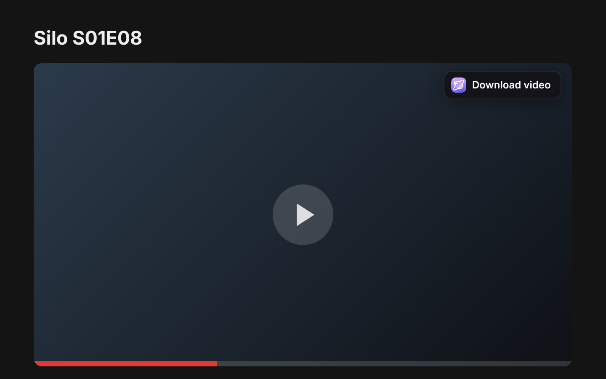
&nbsp;
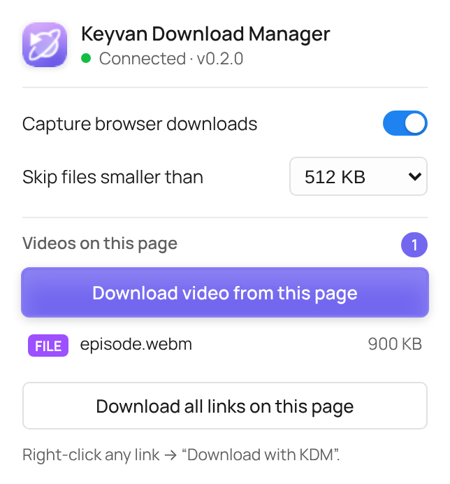
</p>

### 📦 Many files at once

Paste several links, drag them onto the window, or type a pattern such as
`https://site.com/Silo.S01.part[01-06].rar`. VDM expands it into a checklist so you can pick the files you want and
download them now or add them to the queue.

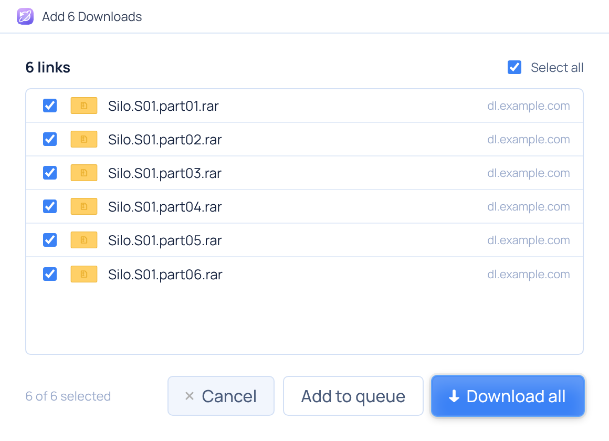

### 🗓️ Download queue and scheduler

- Create **as many queues as you like** (for example *Night downloads*), each with its own schedule, its own number of
  downloads at a time and its own action when it finishes; right-click a download to move it to another queue
- A queue downloads **one file at a time** (you can allow more)
- **Start** and **stop** the queue at set times on chosen days, for example overnight when internet is cheaper
- **When finished**: shut down, sleep, hibernate (Windows) or close VDM, with a 60-second countdown you can cancel

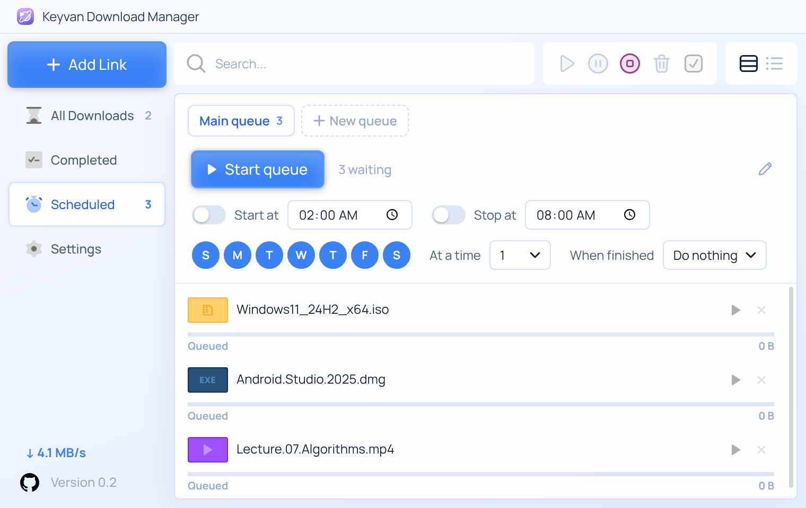

### 🎨 10 themes

Light (default) and Dark, plus **Day, Night, Paper, Mint, Ocean, Neon, Jungle** and **Retro 95**. Each theme also
colors the window title bar to match.

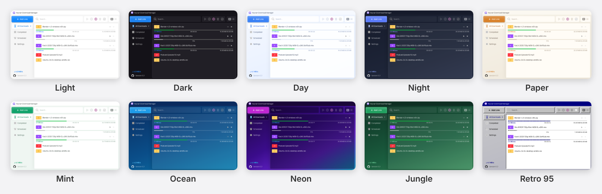

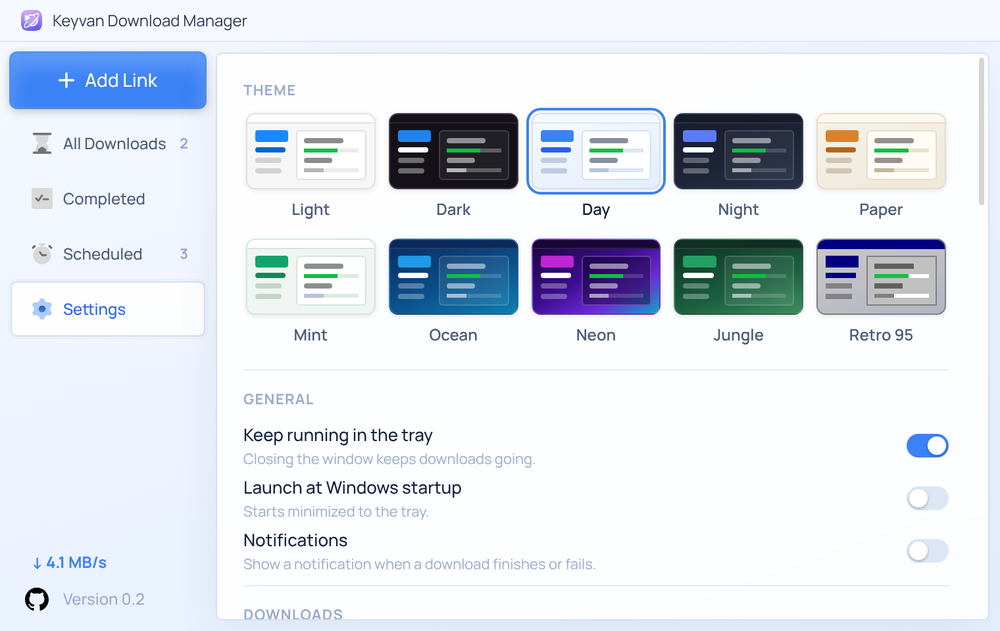

### 🧭 Small things that make it nice

- **Card** and **compact list** views, search, and a toolbar to resume, pause, stop or delete everything at once

  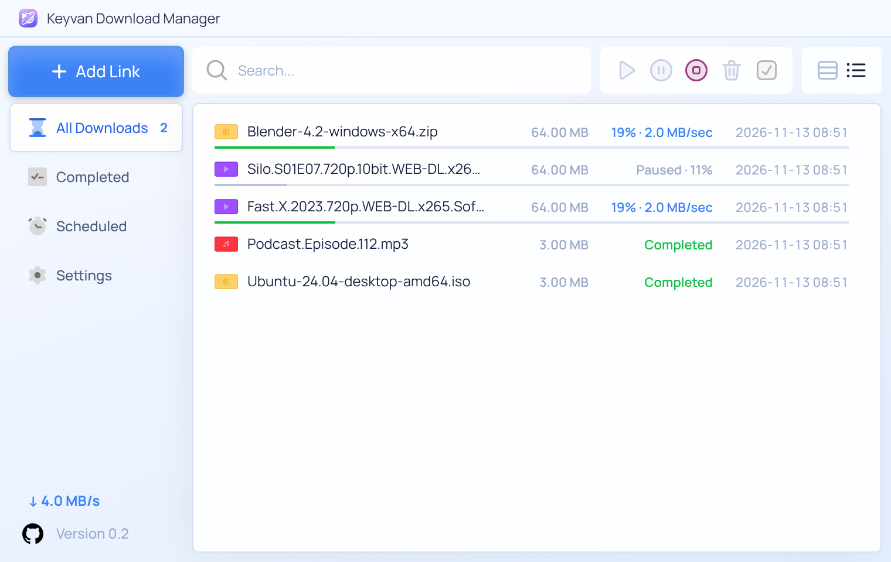

- Before downloading, VDM shows the file name, size and free disk space

  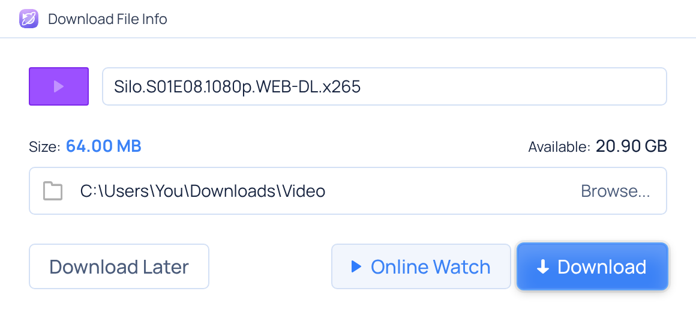

- **Online Watch**: stream a video or song before it finishes downloading (or open it in VLC or PotPlayer)
- Files are sorted into folders by type: Video, Music, Compressed, Documents, Programs
- Copying a download link in any app opens *Add Link* (clipboard monitoring)
- Canceled downloads stay in the list so you can restart them later
- **Proxy:** HTTP, SOCKS5 or your system's proxy, with an optional login, for downloads, videos and updates
  (Settings → Proxy, with a *Test connection* button)

  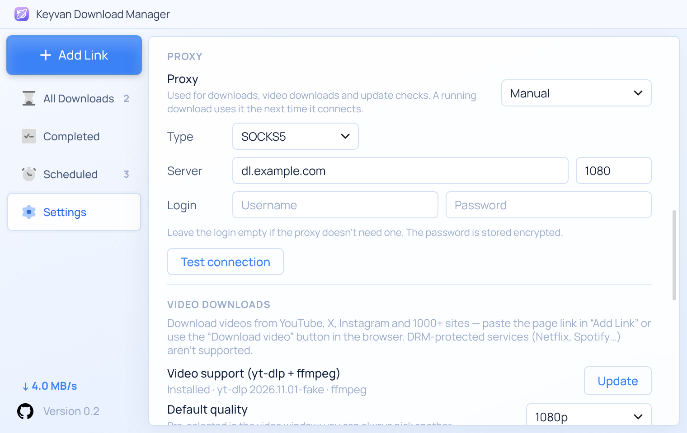

- A **Last try** column in the compact list shows when each download was last attempted
- After an update, a **What's new** window tells you what changed (Settings → About opens it again)

  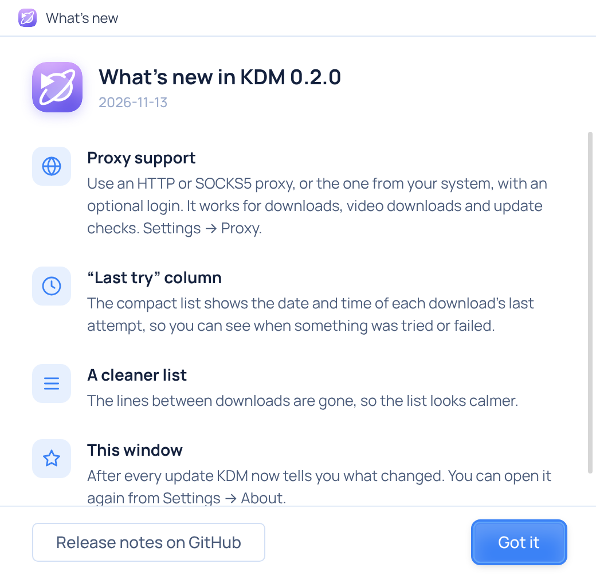

- Tray icon, progress on the taskbar button, notifications, and the PC stays awake while downloading
- SHA-256 checksum of finished files
- **Automatic updates**: VDM checks GitHub Releases, shows an *Update Available!* button in the sidebar, downloads
  the new version and installs it with one click (can be turned off in Settings → About)
- Select several downloads with `Shift`+click (a range) or `Ctrl`+click, or all of them with **Select all** /
  `Ctrl+A`, then resume, pause or delete them together (one confirmation, with the option to delete the files too)
- Keyboard shortcuts: `Ctrl+N` add link · `Ctrl+F` search · `Ctrl+V` paste links · `Space` pause or resume ·
  `Enter` open · `Delete` cancel or remove

<div align="center">
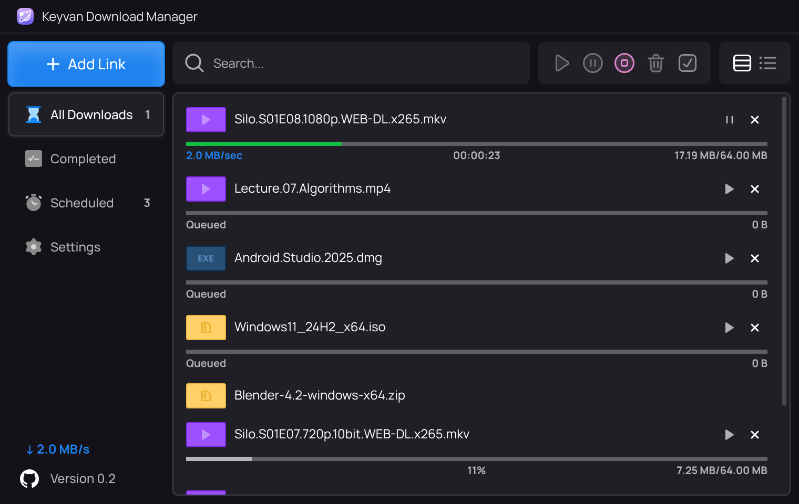
</div>

---

## Install

Use the download buttons at the top of this page, or pick a file on the [Releases](https://github.com/protungtq/vdm/releases/latest) page.

### Windows 10 / 11

1. Download the [installer](https://github.com/protungtq/vdm/releases/latest/download/VDM-Setup.exe), or the
   [portable version](https://github.com/protungtq/vdm/releases/latest/download/VDM-Portable.exe) if you don't want to install anything.
2. The app isn't code-signed yet, so Windows SmartScreen may warn you. Click **More info → Run anyway**.

### macOS 11 or newer

1. Download the file for your Mac:
   - [Apple Silicon (M1, M2, M3, M4…)](https://github.com/protungtq/vdm/releases/latest/download/VDM-mac-arm64.dmg)
   - [Intel](https://github.com/protungtq/vdm/releases/latest/download/VDM-mac-x64.dmg)

   Not sure which one? Apple menu → **About This Mac** → the *Chip* line says Apple M… or Intel.
2. Open the `.dmg` and drag **VN Download Manager** into **Applications**.
3. The app isn't notarized by Apple yet, so the first time macOS refuses to open it. Open
   **System Settings → Privacy & Security**, scroll down and click **Open Anyway** next to the message about VDM
   (on macOS 14 and older you can instead right-click the app and choose **Open**).

### Browser extension

1. Open `chrome://extensions` (or `edge://extensions`) and turn on **Developer mode**.
2. Click **Load unpacked** and select the extension folder. To find it, open **Settings → Browser integration → Open
   extension folder** in VDM.

---

## Build from source

You need [Node.js](https://nodejs.org) 20 or newer.

```bash
git clone https://github.com/protungtq/vdm.git
cd vdm
npm install
npm start          # run the app
npm test           # engine and video-pipeline tests (local test server, no internet needed)
npm run dist:win   # build the installer + portable exe into dist/ (on Linux this needs wine)
npm run dist:mac   # build the macOS .dmg files (on a Mac)
```

Project layout:

| Folder | What's inside |
| --- | --- |
| `src/main/engine/` | Download engine: segments, resume, queue, scheduler |
| `src/main/media/` | Video downloads (yt-dlp and ffmpeg) |
| `src/main/` | Electron main process: windows, tray, browser bridge on `127.0.0.1:17842`, power actions |
| `src/renderer/` | User interface (HTML, CSS, JS) |
| `extension/` | Manifest V3 browser extension |
| `scripts/` | End-to-end checks that drive the real app and browser; `readme-shots.js` makes these screenshots |

The UI uses the **Manrope** font (bundled, SIL Open Font License), so it looks the same on every PC.

## Publishing a new version

1. Raise `version` in `package.json` (for example `0.2.0`) and describe the changes in
   `docs/release-notes/v0.2.0.md`. Commit and push.
2. Push a tag with the same version: `git tag v0.2.0 && git push origin v0.2.0`.
   The **Build release** workflow creates the release on GitHub, builds the Windows and Mac versions on GitHub's own
   machines and attaches them (about 10 minutes). The tag must match `package.json`, or the workflow stops.
   Publishing a release by hand on GitHub works too.
3. Installed copies of VDM find it within a few hours, or right away with **Settings → About → Check now**.

## Privacy and security

- VDM has no accounts, ads or tracking, and sends nothing anywhere except the downloads you start and its update check
  on GitHub.
- Browser cookies (needed to download from sites you're signed in to) are kept only for unfinished downloads,
  encrypted by your operating system (Windows DPAPI / macOS Keychain), and deleted when the download finishes.
- The app only accepts downloads from VDM's own browser extension; web pages and other extensions are refused.
- yt-dlp and ffmpeg are checked against published SHA-256 checksums before they are used.
- The installers aren't code-signed yet (that needs a paid certificate), so Windows and macOS show a warning the first
  time. You can always build VDM yourself from this source code.

## Author

**Mojtaba Navade** (original Keyvan Download Manager) · [Telegram](https://t.me/mojtabatn) · [Instagram](https://www.instagram.com/mojtabanavade)

Forked, renamed and rebranded as VN Download Manager by **TungTQ** · [Game8](https://game8.info) · [GitHub](https://github.com/protungtq)

## License

MIT, see [LICENSE](LICENSE).
