<div align="center">

[English](README.md) · **Tiếng Việt** · [فارسی](README.fa.md)


# VN Download Manager

**Trình quản lý tải xuống gọn nhẹ và nhanh cho Windows và macOS, có sẵn công cụ tải video.**

Tải đa kết nối · Bắt video YouTube, X và hơn 1000 trang · Hàng đợi và hẹn giờ · 10 giao diện

### Tải về

<a href="https://github.com/protungtq/vdm/releases/latest/download/VDM-Setup.exe"></a>
<a href="https://github.com/protungtq/vdm/releases/latest/download/VDM-mac-arm64.dmg">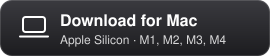</a>
<a href="https://github.com/protungtq/vdm/releases/latest/download/VDM-mac-x64.dmg"></a>

[Bản Portable cho Windows](https://github.com/protungtq/vdm/releases/latest/download/VDM-Portable.exe) (không cần cài đặt) ·
[Tất cả phiên bản và thay đổi mới](https://github.com/protungtq/vdm/releases/latest) · [Cách cài đặt](#cài-đặt)

[](https://github.com/protungtq/vdm/releases/latest)


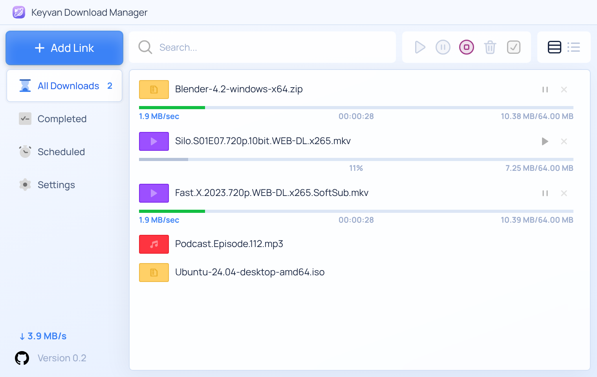

</div>

> **Về bản fork này.** VN Download Manager (VDM) là bản fork được đổi tên và làm lại thương hiệu từ
> [Keyvan Download Manager](https://github.com/mojtabatn/keyvan-download-manager) của Mojtaba Navade,
> phát hành theo cùng giấy phép MIT. Dòng ghi bản quyền của tác giả gốc được giữ nguyên trong
> [LICENSE](LICENSE), và màn hình About của app vẫn ghi công anh ấy. Mọi tính năng bên dưới đều đến từ
> dự án gốc; bản fork này chỉ đổi tên, đổi thương hiệu và đổi nơi kiểm tra cập nhật.

---

## Vì sao nên dùng VDM?

- **Sạch sẽ và tối giản.** Một cửa sổ, một danh sách. Không quảng cáo, không banner, không menu đầy những tùy chọn chẳng bao giờ dùng tới.
- **Nhanh.** Mỗi file được chia thành tối đa 32 phần tải xuống cùng lúc.
- **Tải cả video.** Dán link YouTube hoặc X, chọn chất lượng, xong.
- **Miễn phí và mã nguồn mở** theo giấy phép MIT.

---

## Tính năng

### ⚡ Tải đa phần (tối đa 32 kết nối)

Mỗi file được chia thành nhiều phần tải xuống song song. Khi một kết nối xong sớm, nó sẽ nhận một nửa của phần còn lại lớn nhất, để mọi kết nối đều bận rộn tới cuối (*chia đoạn động*, như IDM).
Mục **Details** hiển thị bản đồ trực tiếp của từng kết nối.

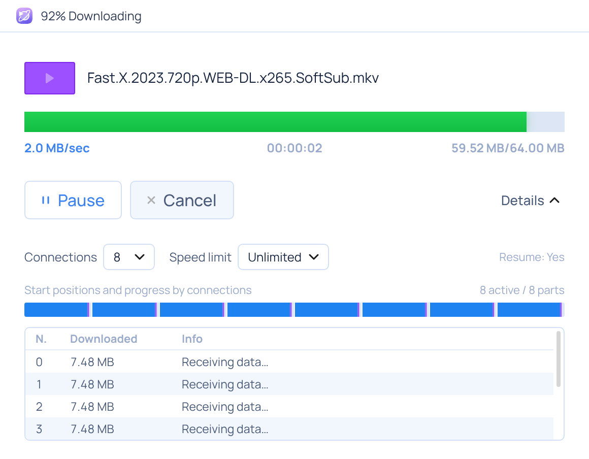

- **Tiếp tục tải (resume)** sau khi tạm dừng, crash, khởi động lại hay mất mạng
- Tự thử lại với thời gian chờ tăng dần
- Tự về một kết nối khi máy chủ không hỗ trợ tải đa phần
- **Làm mới link**: thay link đã hết hạn bằng link mới mà vẫn giữ phần đã tải
- Giới hạn tốc độ cho từng lượt tải, hoặc cho tất cả

### 🎬 Tải video (YouTube, X, Instagram, TikTok, Vimeo, Aparat và hơn 1000 trang)

Dán link của trang vào **Add Link**. VDM tìm video và liệt kê các chất lượng có sẵn kèm dung lượng.
Chọn 4K, 1080p, 720p… hoặc **Chỉ lấy âm thanh (MP3)**. VDM tự gộp video và âm thanh HD thành một file.

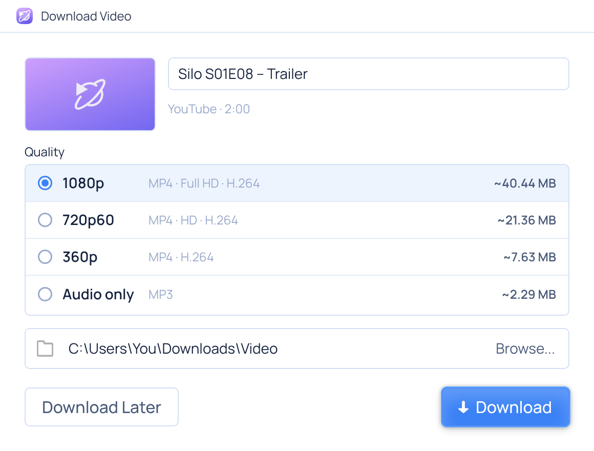

Mục **Video downloads** trong Settings cho phép đặt chất lượng mặc định, nút bấm trên trình duyệt và cập nhật công cụ tải.

> Chạy bằng [yt-dlp](https://github.com/yt-dlp/yt-dlp) và [ffmpeg](https://ffmpeg.org), VDM sẽ tự tải về trong lần đầu bạn dùng tính năng video (khoảng 54 MB). Các dịch vụ có DRM như Netflix hay Spotify không được hỗ trợ.

### 🌐 Tích hợp trình duyệt (Chrome, Edge, Brave)

- Lượt tải bắt đầu trong trình duyệt sẽ đi thẳng vào VDM
- Nút **Download video** xuất hiện khi bạn rê chuột lên một video ở bất kỳ trang nào
- Popup trên thanh công cụ liệt kê mọi luồng video tìm thấy trên trang (HLS `.m3u8`, DASH `.mpd`, MP4, WebM)
- **Tải tất cả link trên trang này**, cùng với *Download with VDM* khi bấm chuột phải vào một link

<p>
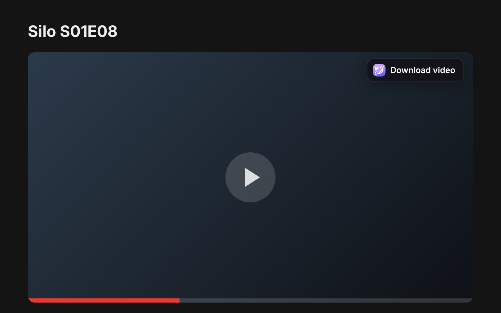
&nbsp;
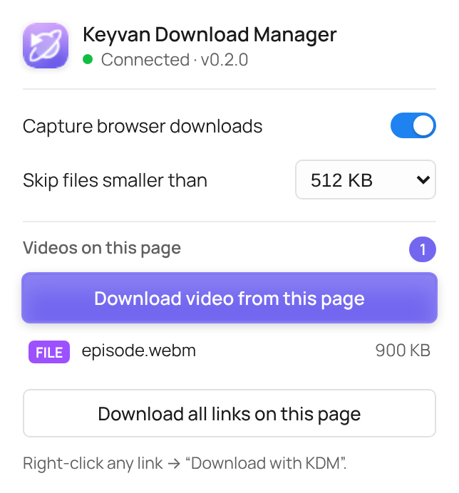
</p>

### 📦 Nhiều file cùng lúc

Dán nhiều link, kéo thả chúng vào cửa sổ, hoặc gõ một mẫu như
`https://site.com/Silo.S01.part[01-06].rar`. VDM sẽ bung mẫu thành danh sách để bạn chọn file muốn tải,
tải ngay hoặc đưa vào hàng đợi.

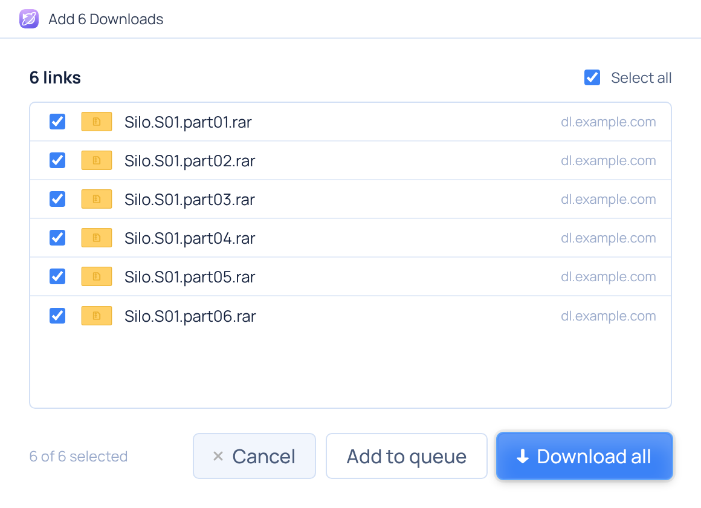

### 🗓️ Hàng đợi và hẹn giờ tải

- Tạo **bao nhiêu hàng đợi tùy thích** (ví dụ *Tải ban đêm*), mỗi hàng đợi có lịch riêng, số lượt tải cùng lúc riêng và hành động riêng khi xong; bấm chuột phải vào một lượt tải để chuyển nó sang hàng đợi khác
- Một hàng đợi tải **một file tại một thời điểm** (bạn có thể cho phép nhiều hơn)
- **Bắt đầu** và **dừng** hàng đợi vào giờ đã đặt trong những ngày đã chọn, ví dụ tải qua đêm khi mạng rẻ hơn
- **Khi xong**: tắt máy, ngủ, ngủ đông (Windows) hoặc đóng VDM, với đếm ngược 60 giây mà bạn có thể hủy

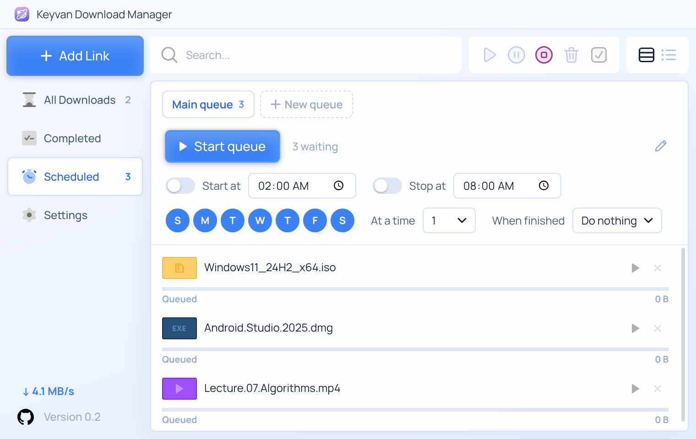

### 🎨 10 giao diện

Sáng (mặc định) và Tối, cùng với **Day, Night, Paper, Mint, Ocean, Neon, Jungle** và **Retro 95**. Mỗi giao diện còn đổi màu cả thanh tiêu đề cửa sổ cho đồng bộ.

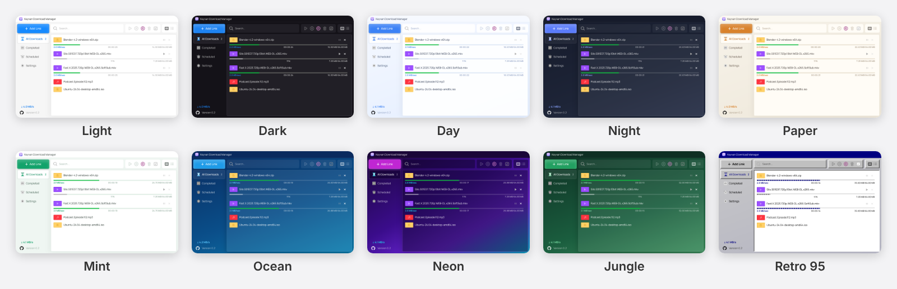

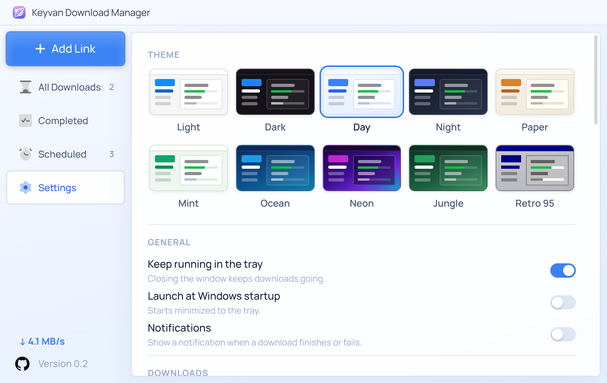

### 🧭 Những chi tiết nhỏ làm nên sự dễ chịu

- Dạng xem **thẻ** và **danh sách gọn**, tìm kiếm, và thanh công cụ để tiếp tục, tạm dừng, dừng hoặc xóa tất cả cùng lúc

  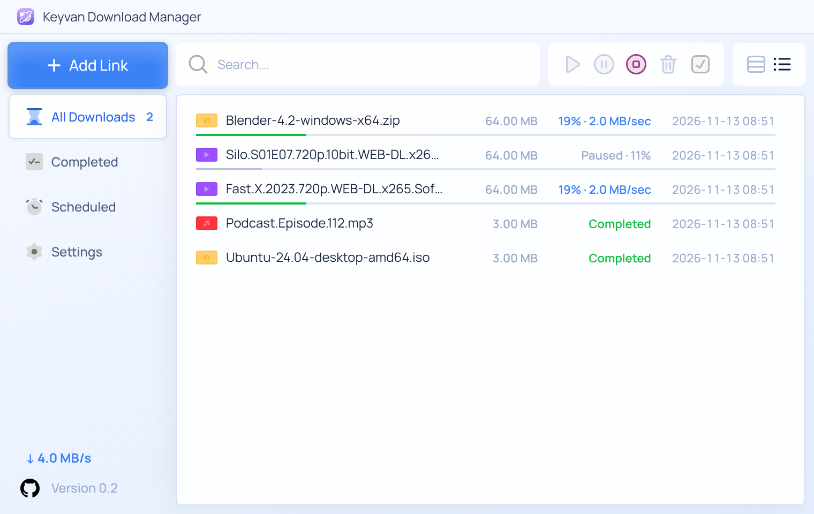

- Trước khi tải, VDM hiển thị tên file, dung lượng và dung lượng đĩa còn trống

  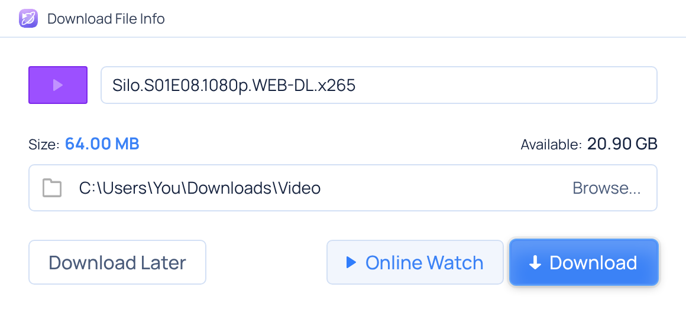

- **Online Watch**: xem trước video hoặc nghe nhạc trước khi tải xong (hoặc mở bằng VLC hay PotPlayer)
- File được xếp vào thư mục theo loại: Video, Music, Compressed, Documents, Programs
- Sao chép một link tải trong bất kỳ app nào cũng sẽ mở *Add Link* (theo dõi clipboard)
- Lượt tải đã hủy vẫn ở trong danh sách để bạn khởi động lại sau
- **Proxy:** HTTP, SOCKS5 hoặc proxy của hệ thống, có thể kèm tài khoản, dùng cho tải file, video và cập nhật
  (Settings → Proxy, có nút *Test connection*)

  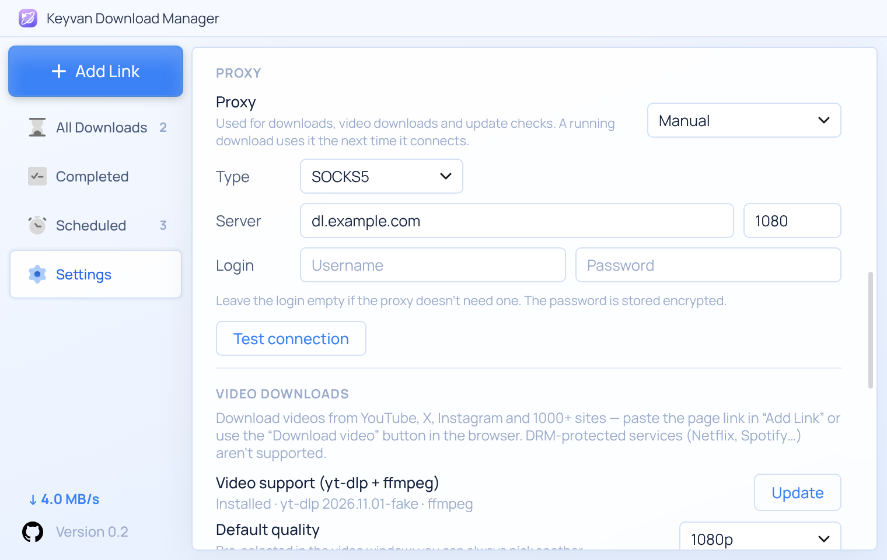

- Cột **Last try** trong danh sách gọn cho biết mỗi lượt tải đã thử lần cuối khi nào
- Sau khi cập nhật, cửa sổ **What's new** cho biết có gì thay đổi (mở lại từ Settings → About)

  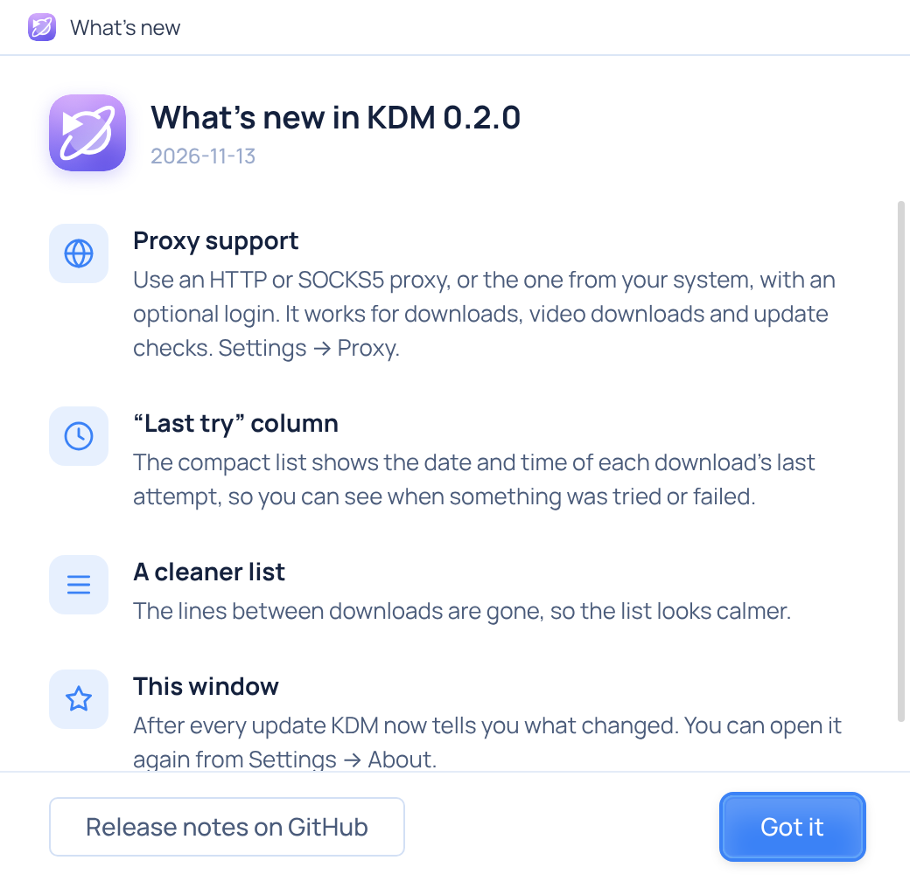

- Icon khay hệ thống, tiến độ trên nút taskbar, thông báo, và máy tính không ngủ trong lúc tải
- Mã kiểm tra SHA-256 của file đã tải xong
- **Tự cập nhật**: VDM kiểm tra GitHub Releases, hiển thị nút *Update Available!* ở thanh bên, tải bản mới và cài đặt chỉ bằng một cú bấm (có thể tắt trong Settings → About)
- Chọn nhiều lượt tải bằng `Shift`+bấm (một dãy) hoặc `Ctrl`+bấm, hoặc tất cả bằng **Select all** /
  `Ctrl+A`, rồi tiếp tục, tạm dừng hay xóa chúng cùng lúc (một lần xác nhận, có tùy chọn xóa cả file)
- Phím tắt: `Ctrl+N` thêm link · `Ctrl+F` tìm kiếm · `Ctrl+V` dán link · `Space` tạm dừng hoặc tiếp tục ·
  `Enter` mở · `Delete` hủy hoặc xóa

<div align="center">
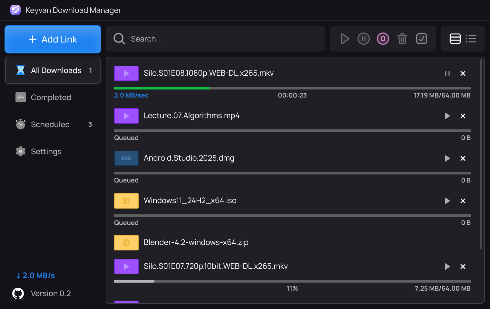
</div>

---

## Cài đặt

Dùng các nút tải ở đầu trang này, hoặc chọn file trong trang [Releases](https://github.com/protungtq/vdm/releases/latest).

### Windows 10 / 11

1. Tải [bản cài đặt](https://github.com/protungtq/vdm/releases/latest/download/VDM-Setup.exe), hoặc
   [bản portable](https://github.com/protungtq/vdm/releases/latest/download/VDM-Portable.exe) nếu bạn không muốn cài đặt gì cả.
2. App chưa được ký mã, nên Windows SmartScreen có thể hiện cảnh báo. Bấm **More info → Run anyway**.

### macOS 11 trở lên

1. Tải file cho máy Mac của bạn:
   - [Apple Silicon (M1, M2, M3, M4…)](https://github.com/protungtq/vdm/releases/latest/download/VDM-mac-arm64.dmg)
   - [Intel](https://github.com/protungtq/vdm/releases/latest/download/VDM-mac-x64.dmg)

   Không chắc máy mình dùng chip nào? Vào Apple menu → **About This Mac** → dòng *Chip* sẽ ghi Apple M… hoặc Intel.
2. Mở file `.dmg` và kéo **VN Download Manager** vào **Applications**.
3. App chưa được Apple notarize, nên lần đầu macOS sẽ từ chối mở. Mở
   **System Settings → Privacy & Security**, kéo xuống và bấm **Open Anyway** cạnh thông báo về VDM
   (trên macOS 14 trở xuống, bạn có thể bấm chuột phải vào app và chọn **Open**).

### Extension trình duyệt

1. Mở `chrome://extensions` (hoặc `edge://extensions`) và bật **Developer mode**.
2. Bấm **Load unpacked** và chọn thư mục extension. Để tìm thư mục này, mở **Settings → Browser integration → Open
   extension folder** trong VDM.

---

## Build từ mã nguồn

Bạn cần [Node.js](https://nodejs.org) 20 trở lên.

```bash
git clone https://github.com/protungtq/vdm.git
cd vdm
npm install
npm start          # chạy app
npm test           # kiểm thử engine và pipeline video (máy chủ kiểm thử nội bộ, không cần mạng)
npm run dist:win   # build bản cài đặt + file exe portable vào dist/ (trên Linux cần wine)
npm run dist:mac   # build file .dmg cho macOS (trên máy Mac)
```

Bố cục dự án:

| Thư mục | Bên trong có gì |
| --- | --- |
| `src/main/engine/` | Engine tải xuống: chia đoạn, resume, hàng đợi, hẹn giờ |
| `src/main/media/` | Tải video (yt-dlp và ffmpeg) |
| `src/main/` | Tiến trình chính của Electron: cửa sổ, khay hệ thống, cầu nối trình duyệt ở `127.0.0.1:17842`, thao tác nguồn |
| `src/renderer/` | Giao diện người dùng (HTML, CSS, JS) |
| `extension/` | Extension trình duyệt Manifest V3 |
| `scripts/` | Kiểm thử end-to-end điều khiển app và trình duyệt thật; `readme-shots.js` tạo các ảnh chụp màn hình này |

Giao diện dùng font **Manrope** (đi kèm, giấy phép SIL Open Font License) nên trông như nhau trên mọi máy tính.

## Phát hành phiên bản mới

1. Tăng `version` trong `package.json` (ví dụ `0.2.0`) và mô tả thay đổi trong
   `docs/release-notes/v0.2.0.md`. Commit và push.
2. Đẩy một tag cùng phiên bản: `git tag v0.2.0 && git push origin v0.2.0`.
   Workflow **Build release** sẽ tạo release trên GitHub, build bản Windows và Mac trên máy của GitHub
   rồi đính kèm (khoảng 10 phút). Tag phải khớp với `package.json`, nếu không workflow sẽ dừng.
   Tạo release bằng tay trên GitHub cũng được.
3. Các bản VDM đã cài sẽ nhận được bản mới trong vài giờ, hoặc ngay lập tức qua **Settings → About → Check now**.

## Riêng tư và bảo mật

- VDM không có tài khoản, quảng cáo hay theo dõi, và không gửi gì đi đâu ngoài các lượt tải bạn bắt đầu và lần kiểm tra cập nhật trên GitHub.
- Cookie trình duyệt (cần để tải từ các trang bạn đã đăng nhập) chỉ được giữ cho các lượt tải chưa xong,
  mã hóa bằng hệ điều hành (Windows DPAPI / macOS Keychain), và bị xóa khi tải xong.
- App chỉ nhận lượt tải từ extension của chính VDM; trang web và extension khác đều bị từ chối.
- yt-dlp và ffmpeg được kiểm tra mã SHA-256 đã công bố trước khi sử dụng.
- Bản cài đặt chưa được ký mã (cần chứng chỉ trả phí) nên Windows và macOS sẽ hiện cảnh báo trong lần đầu tiên.
  Bạn luôn có thể tự build VDM từ mã nguồn này.

## Tác giả

**Mojtaba Navade** (Keyvan Download Manager gốc) · [Telegram](https://t.me/mojtabatn) · [Instagram](https://www.instagram.com/mojtabanavade)

Được fork, đổi tên và làm lại thương hiệu thành VN Download Manager bởi **TungTQ** · [Game8](https://game8.info) · [GitHub](https://github.com/protungtq)

## Giấy phép

MIT, xem [LICENSE](LICENSE).
